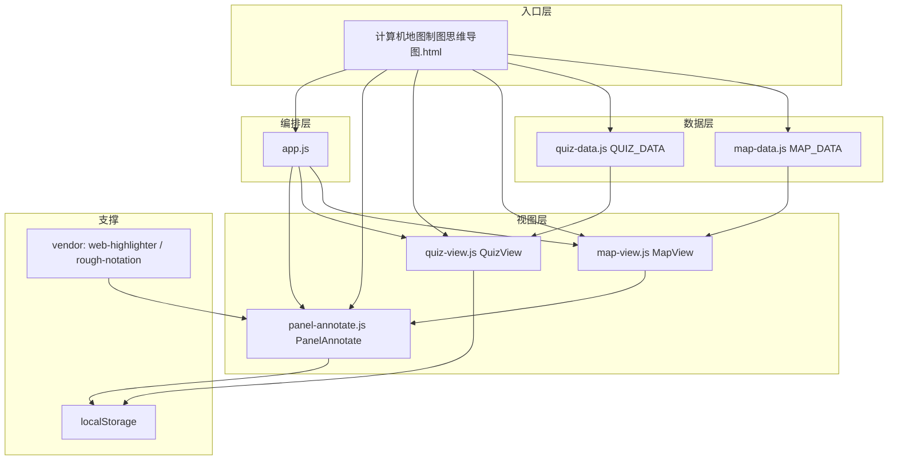
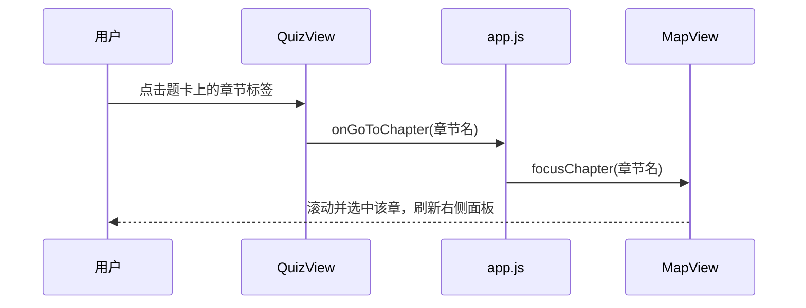

# 架构总览

## 一句话

入口页搭骨架，数据文件提供内容，三个视图模块各自独立渲染，`app.js` 负责把它们的回调接起来。

## 分层



## 加载顺序

入口页按固定顺序引入，后面的依赖前面的全局对象：

```html
base.css → map.css → quiz.css
vendor/web-highlighter.min.js
vendor/rough-notation.iife.js
map-data.js → quiz-data.js
map-view.js → quiz-view.js → panel-annotate.js
app.js                      <!-- 最后，负责启动 -->
```

## 模块职责

| 模块 | 全局对象 | 职责 | 不做什么 |
| --- | --- | --- | --- |
| `map-data.js` | `MAP_DATA` | 知识树结构与正文 | 不含任何逻辑 |
| `quiz-data.js` | `QUIZ_DATA` | 题库数组 | 不含任何逻辑 |
| `map-view.js` | `MapView` | SVG 导图布局、展开收起、缩放、右侧面板 | 不认识题库 |
| `quiz-view.js` | `QuizView` | 卡片渲染、筛选、判题、统计、导入导出 | 不认识导图 |
| `panel-annotate.js` | `PanelAnnotate` | 划词高亮、备注、圈划、持久化 | 不判断当前节点是谁 |
| `app.js` | 无 | 页签切换、双向联动、批注回调转发 | 不写业务细节 |

## 通信方式

视图之间**不直接调用**，只暴露回调，由 `app.js` 接线：



反方向（导图 → 题库）走 `onPracticeChapter` → `setView("quiz")` → `QuizView.jumpToChapter`。

批注模块通过 `map-view` 的 `onPanelReady(node, body)` 回调挂载：面板每次重绘后，由它负责回填该节点的历史批注。

## 页签隔离

两个页签是 `#mapView` 与 `#quizView` 两块独立容器，切换只改 `hidden` 属性。因为两块界面来自不同来源的模板，CSS 全部按容器加前缀（见 [样式规范](05-样式规范.md)），避免互相污染。

## 为什么不用构建工具

目标是「拷给学生、双击就能跑」，所以：

- 所有 JS 用 IIFE + 全局命名空间，不用 `import/export`（`file://` 下模块化加载会被浏览器拦截）。
- 第三方库以本地文件放在 `vendor/`，不依赖 CDN。
- 无 npm、无打包、无转译，改完刷新即可生效。
